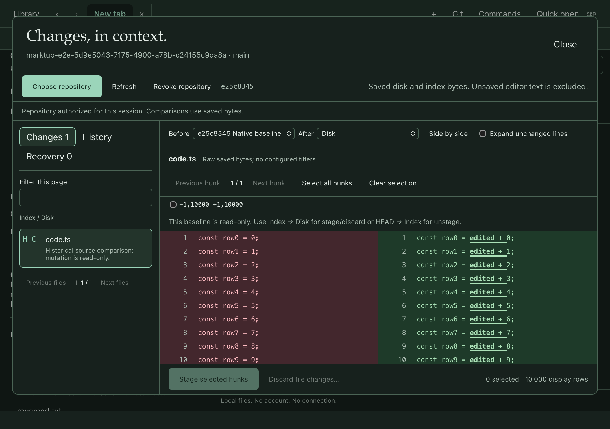

# Marktub

An offline Markdown reader and source-preserving editor for macOS and Linux.



## Features

- **Read, Source, Split and Visual.** Read comfortably, edit Markdown directly,
  preview alongside your source, or use formatting controls that preserve it.
- **Ordinary files and folders.** Tabs, recent files, quick open, bookmarks,
  workspace search and safe file operations, with no vault or account.
- **Technical Markdown.** Tables, footnotes, syntax highlighting, local math,
  equation references and Mermaid diagrams. No remote renderer or font service.
- **Git and document review.** Saved diffs, selected-hunk staging, backed-up
  discard, and optional anchored feedback for changes made outside the app.
- **Export.** Standalone HTML, or PDF through separately installed Pandoc with
  Typst or XeLaTeX.
- **Optional local tools.** Shell, SQLite and trusted TeX jobs require explicit
  enablement, folder trust and confirmation. They start disabled each session.

Marktub uses one system WebView. Installed builds need no Node server and contain
no telemetry.

## Get started

Use a package from [Releases](https://github.com/MohamedElashri/marktub/releases),
or build from source. Install the tools selected by `.node-version`,
`package.json` and `rust-toolchain.toml`, plus the
[Tauri platform prerequisites](https://v2.tauri.app/start/prerequisites/):

```sh
pnpm install --frozen-lockfile
cargo fetch --manifest-path src-tauri/Cargo.toml --locked
pnpm tauri dev
```

Open a file or folder to begin. Files open in Read; the mode buttons switch to
editing. More contains settings, recovery, export and local tools. Quick open
uses Cmd/Ctrl+P; open and save use Cmd/Ctrl+O and Cmd/Ctrl+S.

## File safety and limits

Saves preserve byte provenance, including mixed line endings. External changes
are checked before replacement. Recovery and bundled examples require **Save As**.
Keep app-private storage: it may contain unsaved work, review feedback and backups.

Large documents use bounded Source windows with local undo/find. Unsupported
rich content stays available as source. Images require approval, and text Undo
never deletes copied image files. Close Source sessions before Git mutations.

PDF glyph coverage depends on the selected engine and installed fonts; inspect
export warnings. Shell and TeX run with ordinary user privileges, not in an OS
sandbox. SQLite is read-only unless a confirmed write transaction is requested.

macOS packages are ad-hoc signed and unnotarized. If you trust a blocked download,
use Apple’s [per-app opening flow](https://support.apple.com/en-us/102445).
Marktub does not change trust or quarantine settings.

## Contributing

See [AGENTS.md](AGENTS.md) for setup, checks and packaging, and
[plan.md](plan.md) for the architecture and remaining release qualifications.
Current verification results are in the
[release summary](docs/evidence/release-status.json).

For bugs, include the OS, app revision, reproduction steps and a small redacted
fixture. Original code is [MIT licensed](LICENSE); [NOTICE](NOTICE) and
[third-party notices](THIRD_PARTY_LICENSES.txt) retain upstream terms.
