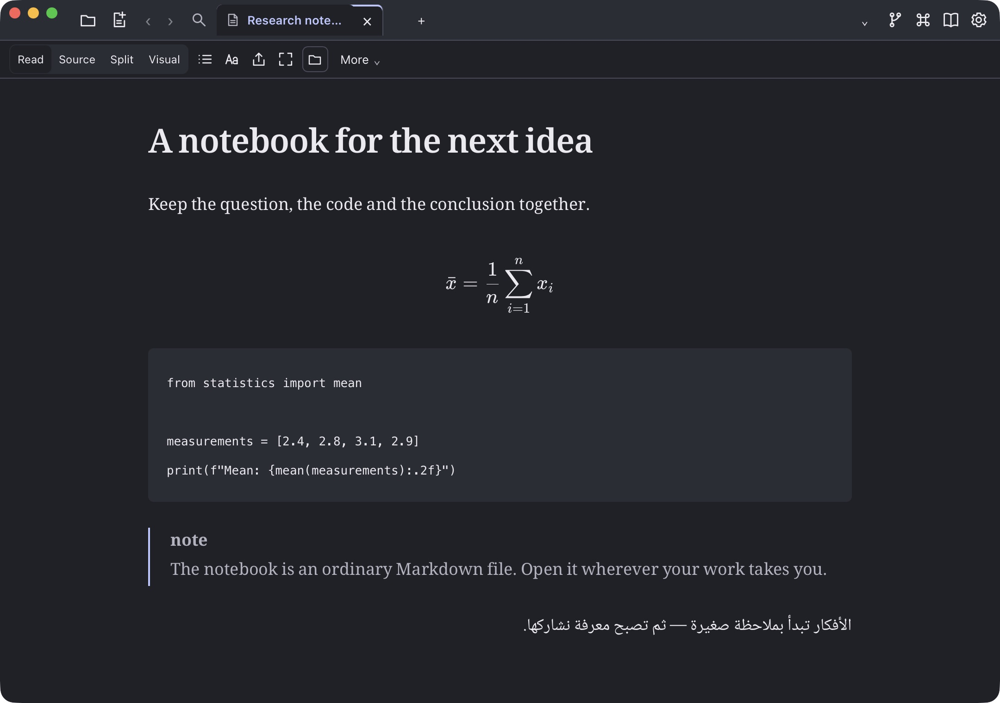
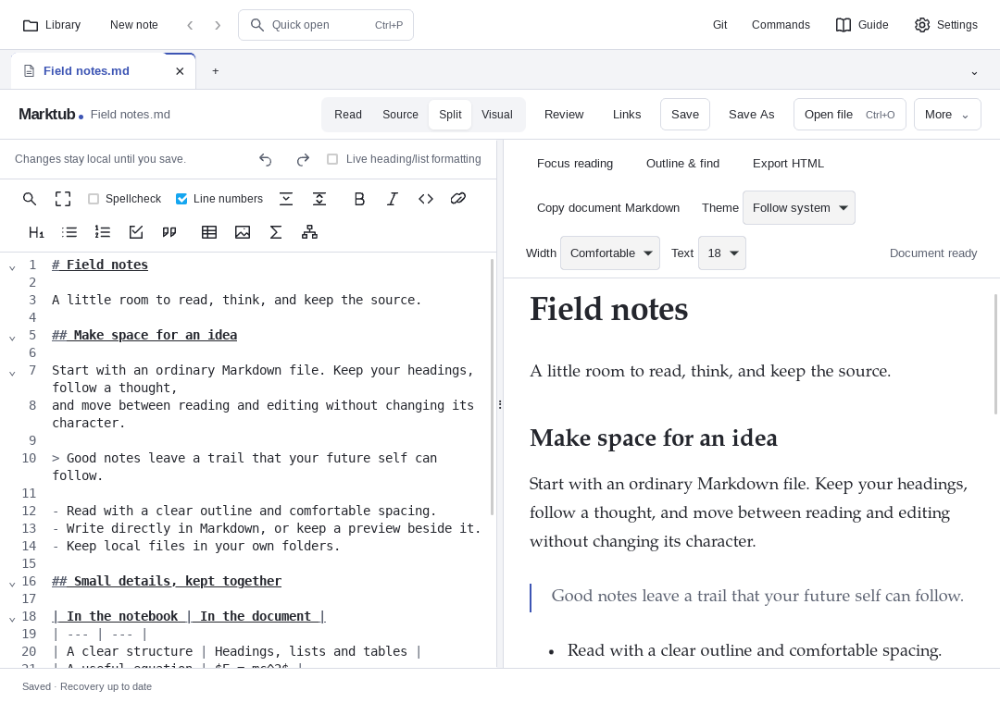

<p align="center">
  
</p>

<h1 align="center">Marktub</h1>

<p align="center"><strong>Read, write and review technical Markdown, offline and in your own files.</strong></p>
<p align="center">macOS · Ubuntu · Free and open source</p>

<p align="center">
  <a href="https://github.com/MohamedElashri/marktub/releases/latest"><strong>Download the latest release</strong></a> ·
  <a href="#get-started">Installation</a> ·
  <a href="https://github.com/MohamedElashri/marktub/issues">Get help</a>
</p>

<p align="center">
  <a href="https://github.com/MohamedElashri/marktub/releases/latest"></a>
  <a href="https://github.com/MohamedElashri/marktub/actions/workflows/install.yml"></a>
  <a href="LICENSE"></a>
</p>

|           Read comfortably, with room for your document           |                        Write Markdown beside its live preview                         |
| :---------------------------------------------------------------: | :-----------------------------------------------------------------------------------: |
|  |  |

## Why Marktub?

- **Work directly with your files.** Open ordinary Markdown files and folders,
  with tabs, search and bookmarks. No import, vault or account required; reading
  and editing stay local, with no telemetry.
- **Make technical writing readable.** Use math, equation references, diagrams,
  tables, images and highlighted code. Switch between Read, Source, Split and
  Visual to read comfortably or work on the Markdown itself.
- **Review changes and share your work.** Inspect Git diffs, stage selected hunks
  and leave optional feedback on saved revisions. Export a standalone HTML copy
  or create a PDF with your selected local tools.

## Get started

Download the [latest release](https://github.com/MohamedElashri/marktub/releases/latest):

- **macOS:** open the universal `.dmg` for Apple Silicon and Intel, then drag
  Marktub to Applications. Packages are ad-hoc signed and unnotarized. If macOS
  blocks the app, verify the official download against the release’s
  `SHA256SUMS`, then remove the installed app’s quarantine flag:

  ```sh
  xattr -dr com.apple.quarantine "/Applications/Marktub.app"
  ```

  For a verified official download you trust, this is safe to run: it removes only
  Marktub’s quarantine metadata, without changing its code or disabling Gatekeeper
  system-wide. You can also use Apple’s
  [per-app opening instructions](https://support.apple.com/en-us/102445).

- **Ubuntu amd64:** download the `.deb` and install it from your Downloads folder:

  ```sh
  sudo apt install ./Marktub_*_amd64.deb
  ```

<details>
<summary>Install with curl or wget</summary>

Use the [installer script](scripts/install.sh) with either command:

```sh
curl -fsSL https://raw.githubusercontent.com/MohamedElashri/marktub/main/scripts/install.sh | bash
```

```sh
wget -qO- https://raw.githubusercontent.com/MohamedElashri/marktub/main/scripts/install.sh | bash
```

The script downloads the latest package and verifies its SHA-256. It installs the
Ubuntu package or opens the macOS disk image. To download without installing,
append `-s -- --download-only` after `bash`.

</details>

**Try a complete workflow:** open a Markdown file or folder, choose **Split** to
write beside the preview, then **Save** your Markdown or **Export HTML** to share
a copy. Use **Git** for saved-file diffs and **Review** for feedback on saved
revisions. Quick open is Cmd/Ctrl+P; open and save are Cmd/Ctrl+O and Cmd/Ctrl+S.

Start a **New note** with Cmd/Ctrl+N, or choose a starter template from the empty
tab or command palette. Drafts stay recoverable until you choose where to save.

Drag tabs to arrange them, resize the Library with its divider, and use **Settings**
to preview themes, fonts and layout changes before applying them. The built-in
**Guide** demonstrates formatting, math, diagrams, images, review and local tools.

<details>
<summary>Advanced tools, file safety and export requirements</summary>

- Saves preserve original byte provenance, including mixed line endings, and
  check external changes before replacement. Recovery and bundled examples need
  **Save As**. Keep app-private storage: it may hold unsaved work and backups.
- Large documents use bounded Source windows with local undo/find. Unsupported
  rich content remains available as source. Images need native approval; text
  Undo never deletes copied images. Close Source sessions before Git mutations.
- PDF export needs separately installed Pandoc with Typst or XeLaTeX. Glyph
  coverage depends on the selected engine and fonts; inspect export warnings.
- Optional Shell, SQLite and trusted TeX jobs start disabled each session and
  need enablement, folder trust and confirmation. Shell and TeX use ordinary OS
  privileges; SQLite is read-only unless you confirm a write transaction.
- Marktub does not change system trust or quarantine settings.

</details>

## Contributing

See [development.md](development.md) for setup, checks and contribution guidance.

For bugs, [open an issue](https://github.com/MohamedElashri/marktub/issues) with the OS, app revision, reproduction steps and and I welcome PR fix.

## LICENCE

The repository and project is [MIT licensed](LICENSE).
