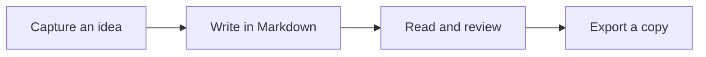

# A place for unfinished thoughts

Welcome to Marktub. This built-in guide is an ordinary Markdown document:
switch to **Split** to see how each example is written, or **Visual** to try the
formatting tools. Use **Save As** to keep your own copy.

[Read and write](#read-and-write) · [Notes and navigation](#notes-and-navigation) ·
[Formatting](#formatting) · [Math](#math-and-equation-references) ·
[Diagrams](#diagrams) · [Images](#local-images) · [Review](#git-and-review) ·
[Export](#sharing-and-export) · [Local tools](#optional-local-tools)

## Read and write

| Mode | Use it for |
| --- | --- |
| **Read** | Reading, finding text, following headings and bookmarking a place. |
| **Source** | Editing the Markdown directly, with find/replace and undo/redo. |
| **Split** | Writing beside the live preview. Drag the middle divider to adjust the panes. |
| **Visual** | Formatting Markdown with local heading, list, table, link and image controls. |

Try selecting a word in Source, then choose **Bold** or **Italic**. The tools
edit the Markdown itself. Find/replace, folding, line numbers, spellcheck and
writing focus are available in the editor.

**Save** writes an ordinary file. Recovery keeps acknowledged edits separately;
it does not replace saving. This app-owned guide and recovered documents require
**Save As**. Existing line endings and untouched source bytes are preserved.[^files]

## Notes and navigation

- **Library** opens your selected local folders. Click a filename to open it;
  use checkboxes for file-management selections.
- **Quick open** finds files in selected folders. The library also supports
  content search, pinned recent files, sorting and list, compact or grid views.
- Drag the library's divider to set its width. Arrow keys also resize it when
  the divider has focus; double-click resets it.
- Drag a tab to reorder it. **Tab actions** offers Move left/right, a list of
  open tabs and Close. Use **Ctrl+Tab** to switch between tabs.
- **Manage files** in the library can create a file or folder, rename, copy,
  move or send selected files to Trash. Review the destination before confirming.
  Close Source sessions before library mutations.
- Use the back/forward arrows for recently visited files. After restarting,
  reselect a folder to authorize it, then restore its saved tabs.

Use the tab menu to find a document when many tabs are open. Settings and the guide are available from
the top bar, and **Commands** lists actions with your current shortcuts.

## Make the workspace yours

Open **Settings** directly, or use **Cmd/Ctrl+,**. Search for “font”, “width”,
“wrap” or “shortcut”. Try a scheme, accent color, font or size and watch the
preview before applying it. Turn off document preview to compare with your saved
appearance. **Revert changes** restores the draft; **Cancel** leaves saved
settings alone.

Riwaq Day and Night offer cream or navy with gold accents. **Use Riwaq typography**
sets reading, heading, interface and code fonts separately from the color scheme.
Open Arabic fonts are bundled; installed Thmanyah is supported. HTML export keeps
the reading theme and embeds the bundled fonts. PDF uses the converter’s print layout.

Choose whether settings apply to the app, a selected workspace, one file, or
only this session. The Markdown document stays unchanged. Shortcuts and library
width are app-wide or session-only. Reading and Source have separate typography
controls, and custom themes check text contrast before they can be applied.

## Formatting

A note can contain **strong emphasis**, *emphasis*, ~~strikethrough~~ and
`inline code`. A [local heading link](#diagrams) jumps within the document.

> A document is a conversation with a future reader.

> [!TIP]
> Read this guide in Split to compare the source with its rendered result.

### Lists and tasks

- Capture an idea.
  - Add a detail beneath it.
- Keep the next action close to the thought.

1. Write a first draft.
2. Read it back.
3. Share a finished copy.

- [x] Open the built-in guide.
- [ ] Try a different reading size.
- [ ] Save a copy for your own experiments.

Tasks display as checkboxes in Read. Edit their Markdown in Source or Visual.

### Tables and code

| Detail | Why it matters |
| --- | --- |
| Ordinary files | No import or vault |
| Original bytes | No surprise formatting |
| العربية · עברית · 日本語 · 🦀 | More than ASCII |

```rust
fn main() {
    println!("Keep the source.");
}
```

Fenced code is highlighted locally. In Source or Visual, use the table tool to
edit cells or add and remove rows and columns.

## Math and equation references

Inline math fits into a sentence: $a^2 + b^2 = c^2$.

$$
\begin{equation}
E = mc^2
\label{eq:energy}
\end{equation}
$$

Equation $\eqref{eq:energy}$ has a document-wide label. Math fonts and renderers
are bundled locally; nothing is downloaded to display a formula.

## Diagrams



Use the **Diagram** tool in the editor to insert or edit a Mermaid fence.
Diagram rendering is local. Unsupported or oversized rich blocks keep a source
fallback so their text remains available.

## Local images


Select the image placeholder above to display the bundled example image.
For your own notes, use **Image** to select a local PNG or JPEG. You can link it
or explicitly copy it to a new destination; undoing text does not delete copied
image files. Images from selected folders can be authorized through that folder.
Remote images do not load automatically.

## Git and Review

**Git** opens the workbench for an explicitly selected local repository. Inspect
saved-file changes, compare revisions and stage or unstage selected native hunks.
Close live Source sessions before changing the index or discarding files.
Discard creates a durable backup first.

**Review** is optional feedback on saved captures: mark a revision reviewed,
attach comments to verified source ranges, inspect changes since that review,
and export feedback. It does not write changes into the document. Unsaved review
drafts require an explicit discard before leaving.

These features need your own selected repository or document; the guide does
not create sample repositories or change files on your behalf.

## Sharing and export

- **Export HTML** produces a standalone, script-free copy with local fonts and
  approved images embedded. Finish document indexing before exporting.
- **More → Export & run → PDF** uses your selected local Pandoc and Typst or
  XeLaTeX. Choose a saved or acknowledged working revision, review warnings,
  then export to a new native destination.
- Copy shown text from Read when you need a short excerpt.

PDF conversion tools are separate installations. Inspect the result for fonts,
page breaks and layout before sharing or printing. If Typst is slow to scan
installed fonts, choose **PDF fonts → Bundled fonts** for Arabic, Latin and math.
Keep **System fonts** when other scripts or installed families are needed.

## Optional local tools

The following fences demonstrate the supported local-tool syntax. They are
**inert by default**. Open **Export & run → Document fences** to inspect a
captured block, enable its tool kind, select a tool and folder or database, and
confirm the exact captured code before running it.

### Shell

```sh
printf 'A note can also be a reproducible notebook.\n'
```

Shell commands run with your normal OS privileges in a selected trusted folder.
You can cancel jobs; output and runtime are bounded.

### SQLite

```sql
SELECT 'A local query' AS note, 1 + 1 AS result;
```

Select a local database separately. Queries start read-only; writes require an
explicitly confirmed DML transaction. No extensions or database attachments are
allowed.

### TeX

```latex
\documentclass{article}
\begin{document}
A small local document: $a^2+b^2=c^2$.
\end{document}
```

Trusted TeX uses a separately selected tool and folder, with shell escape
disabled. It has ordinary OS privileges; it is not an OS sandbox.

## Keep a thought in plain text

Use this guide as a reference, or save a copy and make it your own. The **Guide**
button and command palette can reopen the original whenever you need it.

[^files]: File permissions and expected-base checks help detect external changes.
    Recovery, saved backups and export copies have separate lifecycles; keep
    app-private recovery data if you might need unsaved work.

## Start a new note

Use **New note** or Cmd/Ctrl+N for a blank draft. Choose **From template** in an
empty tab, or **New note from template** in Commands, for notes, meetings or a
daily journal. The draft is kept in recovery; Save opens a native Save As dialog.

## Connect notes

Use `[[Note]]`, `[[folder/Note]]` or `[[Note#Heading|label]]` to connect Markdown
files. Open the containing folder in Library, then use **Links** for outgoing
links and backlinks in saved files. Bare names prefer the same folder; otherwise
only unique matches open automatically. Ambiguous or partial scans ask you to
choose. Backlinks exclude hidden, ignored and symlinked files and report limits.

## Browse and search folders

Expand folders in Library’s **Files** view. **File details** contains sorting,
filters, preview and file operations. Cmd/Ctrl+P filters filenames as you type;
Cmd/Ctrl+Shift+F opens content search. Search results stay in the dialog. Use
arrows and Enter to open one, or Preview to inspect it first. Closing search
cancels its own job; it never cancels an unrelated file operation.
